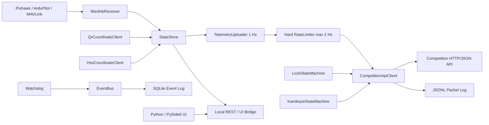

# TEKNOFEST 2026 Communication Core Service

Bu proje, Savaşan İHA yarışması için yer istasyonunda bağımsız çalışan C++20 haberleşme çekirdeğidir. Servis; MAVLink telemetrisini alır, yarışma sunucusuyla HTTP/JSON konuşur, paketleri JSONL olarak kaydeder, kritik olayları SQLite veritabanına yazar ve Python/PySide6 arayüzünden bağımsız çalışır.

## Mimari



## Build

```bash
cmake -S communication_core -B communication_core/build -DCMAKE_BUILD_TYPE=Release
cmake --build communication_core/build -j
```

Testler:

```bash
ctest --test-dir communication_core/build --output-on-failure
```

İnternetsiz ortamda bağımlılıklar önceden sistemde kuruluysa:

```bash
cmake -S communication_core -B communication_core/build -DCOMM_CORE_FETCH_DEPS=OFF
```

## Config

Ana dosya: `config/config.yaml`

- `server.base_url`: yarışma veya mock sunucu adresi
- `server.timeout_ms`: HTTP bağlantı ve okuma zaman aşımı
- `server.max_retries`: 400/500/transport hatalarında kontrollü tekrar sayısı
- `telemetry.upload_hz`: varsayılan 1 Hz gönderim
- `telemetry.max_allowed_hz`: kesin üst limit, varsayılan 2 Hz
- `logging.packet_log_path`: tüm gelen/giden JSON paketlerinin JSONL kaydı
- `logging.sqlite_path`: kritik olay SQLite veritabanı
- `ipc.rest_port`: UI için local durum API portu
- `vehicle_manager.enabled`: Jetson Vehicle Manager hava-yer köprüsünü açar
- `vehicle_manager.telemetry_source`: `vehicle_manager` ise telemetri Jetson status mesajından, `mavlink` ise yer istasyonu MAVLink receiver'dan alınır
- `vehicle_manager.heartbeat_port`: Vehicle Manager status/heartbeat UDP dinleme portu
- `vehicle_manager.event_port`: Vehicle Manager lock/kamikaze JSON line TCP event portu
- `vehicle_manager.vehicle_command_host`: Jetson IP adresi
- `vehicle_manager.vehicle_command_port`: Jetson'a gönderilecek UDP komut portu

## Vehicle Manager Entegrasyonu

Jetson Xavier NX üzerinde çalışan Python Vehicle Manager ile yer istasyonu arasında üç port kullanılır:

- `9100/UDP`: Jetson -> yer istasyonu status/heartbeat
- `9101/TCP`: Jetson -> yer istasyonu JSON line görev eventleri
- `9102/UDP`: yer istasyonu -> Jetson komutları

Yer istasyonu Vehicle Manager'dan gelen status mesajını `VehicleState` yapısına map eder. `vehicle_manager.telemetry_source: "vehicle_manager"` seçiliyse `MavlinkReceiver` başlatılmaz ve telemetri yarışma sunucusuna Jetson status payload'ındaki son araç durumundan gönderilir.

Jetson'dan gelen event tipleri:

- `LOCK_CONFIRMED`: payload `LockPacket` olarak parse edilir ve `/api/kilitlenme_bilgisi` endpointine iletilir.
- `KAMIKAZE_CONFIRMED`: payload `KamikazePacket` olarak parse edilir ve `/api/kamikaze_bilgisi` endpointine iletilir.

Duplicate eventler `event_id` ile engellenir. `event_id` yoksa `type + timestamp_ms + payload` değerinden stabil bir hash üretilir.

Yer istasyonundan Jetson'a gönderilen komut tipleri:

- `SET_HSS`
- `QR_TARGET`
- `MISSION_START`
- `MISSION_STOP`
- `MANUAL_OVERRIDE`
- `TIME_SYNC`

Local REST tetikleyicileri:

- `POST http://127.0.0.1:8090/vehicle/send_qr`: yarışma sunucusundan QR koordinatını alır ve Jetson'a `QR_TARGET` gönderir.
- `POST http://127.0.0.1:8090/vehicle/send_hss`: yarışma sunucusundan HSS koordinatlarını alır ve Jetson'a `SET_HSS` gönderir.

Örnek Jetson status heartbeat testi:

```bash
echo '{"type":"status","vehicle_id":"vehicle-1","timestamp_ms":1700000000000,"mavlink_connected":true,"vehicle_state":{"latitude":39.9,"longitude":32.8,"altitude":120.0,"pitch":1.0,"yaw":2.0,"roll":3.0,"ground_speed":24.0,"battery_percent":87,"autonomous_mode":true,"lock_active":false,"gps_time":{"saat":12,"dakika":34,"saniye":56,"milisaniye":123}}}' \
  | nc -u -w1 127.0.0.1 9100
```

Örnek lock event testi:

```bash
printf '%s\n' '{"type":"LOCK_CONFIRMED","event_id":"lock-1","vehicle_id":"vehicle-1","timestamp_ms":1700000000000,"payload":{"kilitlenmeBitisZamani":{"saat":12,"dakika":34,"saniye":56,"milisaniye":123},"otonom_kilitlenme":1}}' \
  | nc 127.0.0.1 9101
```

`/status` çıktısı Vehicle Manager alanlarını da içerir: bağlantı durumu, son görülme yaşı, son status/event ve son komut sonucu.

## Mock Server

```bash
cd communication_core/mock_server
python -m venv .venv
source .venv/bin/activate
pip install fastapi uvicorn
uvicorn main:app --host 127.0.0.1 --port 5000
```

Senaryo değiştirme:

```bash
curl -X POST http://127.0.0.1:5000/scenario \
  -H 'Content-Type: application/json' \
  -d '{"scenario":"500"}'
```

Desteklenen senaryolar: `normal`, `401`, `400`, `500`, `delayed`, `empty_hss`, `non_empty_hss`, `opponents`.

## Servisi Çalıştırma

```bash
./communication_core/build/communication_core_service communication_core/config/config.yaml
```

Local UI durum endpointleri:

- `GET http://127.0.0.1:8090/healthz`
- `GET http://127.0.0.1:8090/status`

UI kapansa bile bu servis ayrı proses olarak çalışmaya devam eder. Yarışma ağına tek IP çıkışı tasarımı korunur; UI doğrudan yarışma sunucusuna değil bu servise bağlanmalıdır.

## Yarışma Günü Sırası

1. Ağ ve tek çıkış IP doğrulaması yapılır.
2. Mock server ile login, telemetri, HSS ve QR akışı denenir.
3. `config.yaml` yarışma sunucusu adresi ve takım bilgileriyle güncellenir.
4. Communication Core Service başlatılır.
5. UI başlatılır ve local `/status` üzerinden bağlantı durumları kontrol edilir.
6. MAVLink akışı kesilip geri getirilerek watchdog bildirimi doğrulanır.
7. JSONL ve SQLite log dosyalarının yazıldığı kontrol edilir.

## Loglar

- `logs/service.log`: spdlog konsol/dosya servis logu
- `logs/packets.jsonl`: `timestamp`, `direction`, `endpoint`, `http_status`, `payload`, `error_message`
- `logs/events.db`: `event_log` tablosunda kritik olaylar

## Hata Durumları

- `401`: servis otomatik tekrar login dener.
- `400` / `500`: servis çökmez, olay loglanır ve retry politikası uygulanır.
- MAVLink kesintisi: watchdog `MAVLINK_DISCONNECTED` olayı üretir, UI son geçerli verinin yaşını `/status` ile görür.
- Vehicle Manager heartbeat kesintisi: `VEHICLE_MANAGER_DISCONNECTED` olayı üretir.
- Sunucu kesintisi: retry uygulanır, İHA kontrol akışı kilitlenmez.
- Geçersiz telemetri: paket gönderilmez, `VALIDATION_ERROR` ve `TELEMETRY_REJECTED` olayları yayınlanır.
- Geçersiz Vehicle Manager JSON/event payload'u servis çökertmez; reject/log olayı üretir.

## Genişletme Noktaları

- `MavlinkReceiver`: MAVSDK veya MAVLink C decoder adaptörü burada bağlanır.
- `LocalWebSocketServer`: mevcut local REST köprüsü korunarak websocket yayın katmanı eklenebilir.
- `CompetitionApiClient`: endpoint bazlı token/header gereksinimleri yarışma dokümanı kesinleşince burada özelleştirilir.
- `VehicleManagerReceiver`: Jetson tarafındaki Python Vehicle Manager ile UDP/TCP JSON köprüsüdür.
