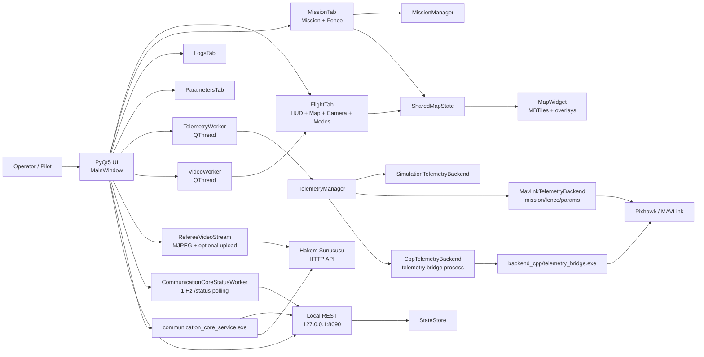
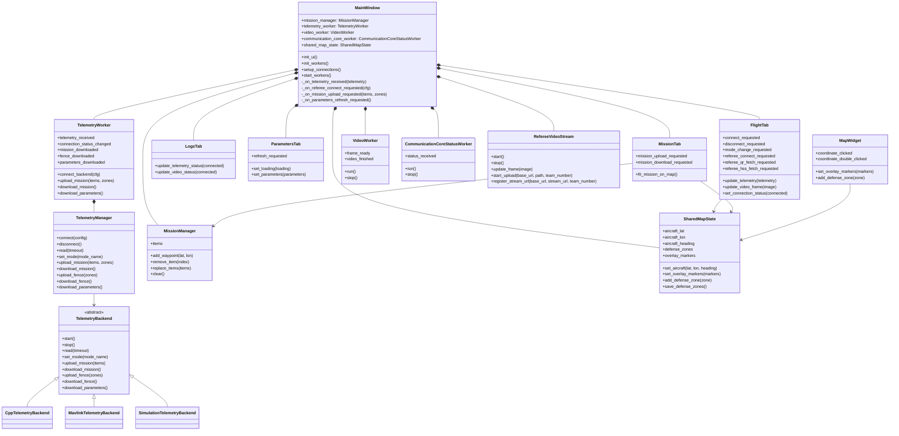
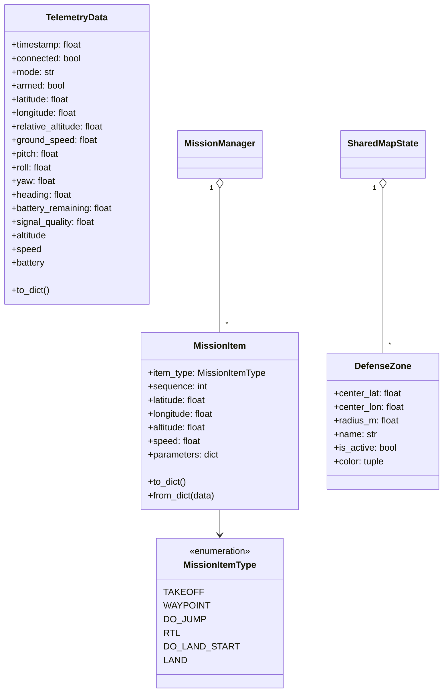
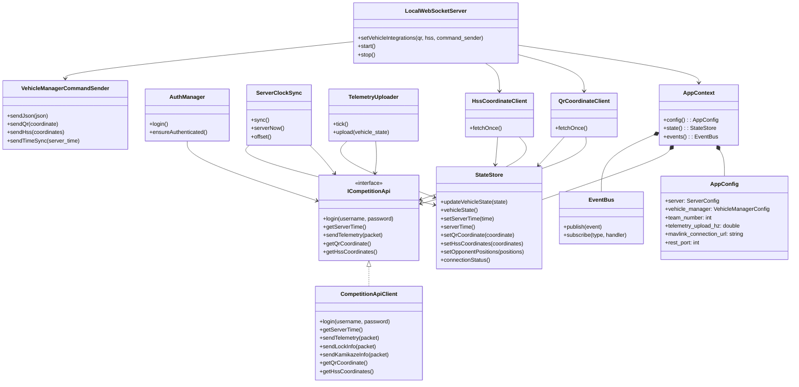
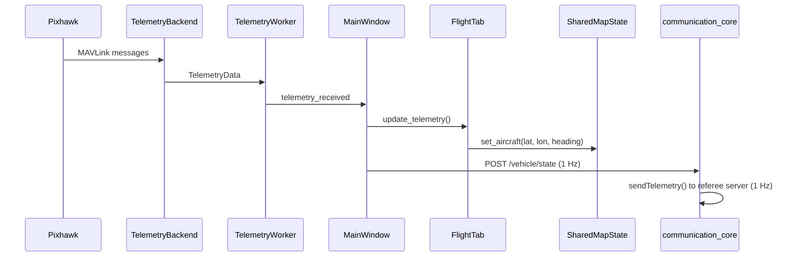
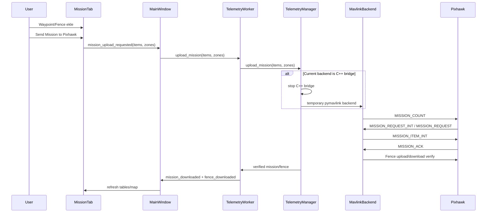
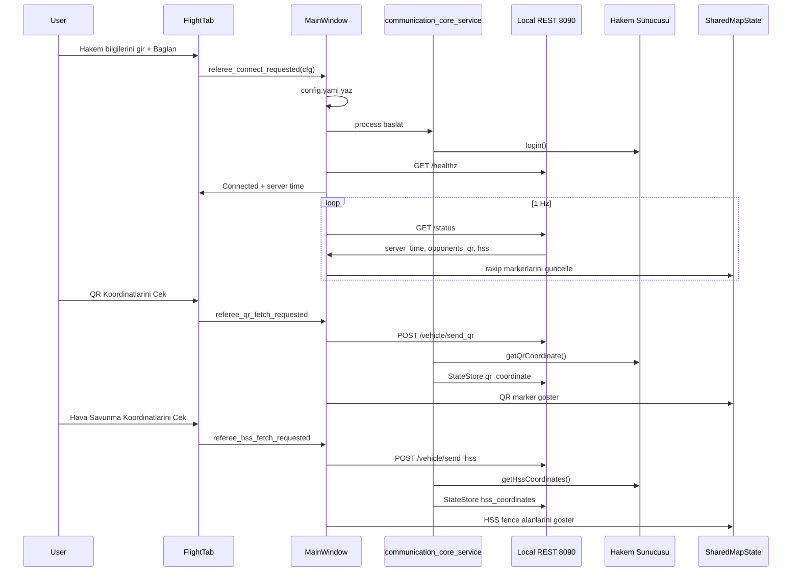
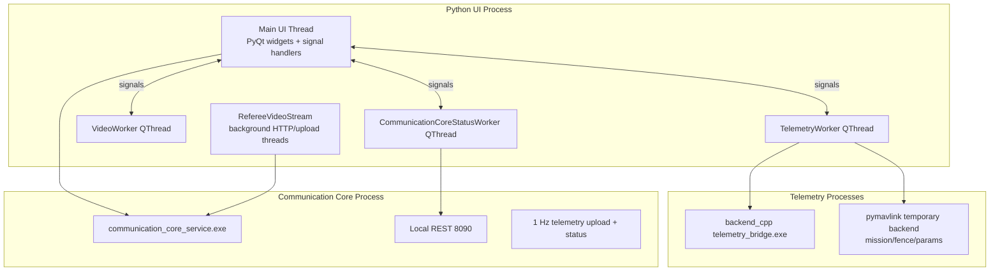

# BLACK BOX Yer Kontrol Istasyonu - UML

Bu dokuman projenin ana mimarisini UML/Mermaid diyagramlariyla ozetler. Diyagramlar uygulamadaki gercek modullere gore hazirlanmistir:

- PyQt5 yer istasyonu arayuzu
- MAVLink/Pixhawk telemetri ve mission katmani
- Hakem sunucusu icin ayri C++ `communication_core` servisi
- Kamera, harita, gorev, fence ve parametre akislarinin baglantilari

## 1. Genel Komponent Diyagrami

## 2. Python Yer Istasyonu Sinif Diyagrami

## 3. Veri Modeli UML

## 4. C++ Communication Core Sinif Diyagrami

## 5. Telemetri Akis Sequence Diyagrami

## 6. Mission/Fence Gonderme Sequence Diyagrami

## 7. Hakem Sunucusu Akis Sequence Diyagrami

## 8. Thread ve Process Mimarisi

## 9. Kisa Sorumluluk Ozeti

| Katman | Ana siniflar | Sorumluluk |
|---|---|---|
| UI | `MainWindow`, `FlightTab`, `MissionTab`, `LogsTab`, `ParametersTab` | Kullanici etkilesimi ve ekran guncellemeleri |
| Harita | `SharedMapState`, `MapWidget`, `MissionManager` | Harita gorunumu, waypoint, fence, QR/rakip overlay |
| Telemetri | `TelemetryWorker`, `TelemetryManager`, `TelemetryBackend` | Pixhawk baglantisi, veri okuma, mode/mission/fence/param komutlari |
| Video | `VideoWorker`, `VideoWidget`, `RefereeVideoStream` | Kamera goruntusu ve hakem tarafina video aktarimi |
| Hakem servis | `communication_core_service`, `CompetitionApiClient`, `StateStore` | Hakem login, telemetri gonderme, server time, QR/HSS/rakip verisi |
| Veri modelleri | `TelemetryData`, `MissionItem`, `DefenseZone` | Uygulama icinde tasinan temel veri yapilari |

